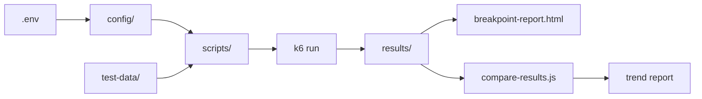

# k6 Performance Testing

k6 load, stress, spike and soak tests against public demo APIs, by
**Wondwosen Asegid, SDET**. A small, honest practice repo: real scripts,
real thresholds, no invented results.

> No work or client system is tested here. The targets are public demo
> APIs only: https://jsonplaceholder.typicode.com and https://httpbin.org.
> The load is kept light on purpose, because these are shared demo APIs.

## Folder tree

```text
k6-performance-testing/
├── config/          # Base URLs (environments.js), load shapes (scenarios.js), thresholds (thresholds.js)
├── test-data/       # Request payloads and expected values (JSON)
├── scripts/         # load-test.js, stress-test.js, spike-test.js, soak-test.js, breakpoint-test.js, run-breakpoint.sh, breakpoint-report.js, compare-results.js
├── lib/             # Shared helpers (common.js)
├── docs/            # SETUP.md, TESTING.md
├── results/         # k6 run outputs (git-ignored)
├── ARCHITECTURE.md  # Folder layout, data flow, how to add a new test
└── .env.example     # Safe-default env vars (no secrets)
```

No script hard-codes a base URL, VU count, duration, threshold,
timeout or expected value: those live in `config/` and `test-data/`
and are imported. See [ARCHITECTURE.md](ARCHITECTURE.md) for the data
flow and how to add a new test.

## What is in here

| Script | What it does |
| --- | --- |
| `scripts/load-test.js` | Steady load: 10 virtual users for 1 minute |
| `scripts/stress-test.js` | Ramps 10 → 25 → 50 → 100 VUs, then back to 0 (about 2 minutes) |
| `scripts/spike-test.js` | Sudden jump 5 → 50 VUs, hold, then back down (about 1 minute 20 seconds) |
| `scripts/soak-test.js` | Steady low load, 10 VUs for 5 minutes (shortened, see below) |
| `scripts/breakpoint-test.js` | Ramps 5 → 200 VUs in steps, then back to 0 (about 4 minutes); finds the breaking point |
| `scripts/compare-results.js` | Node script (no k6 needed): compares two k6 summary JSON files and prints the trend for p95, avg, max, error rate and checks pass rate, plus a PASS/FAIL verdict for each run against the thresholds in `config/thresholds.js` |
| `lib/common.js` | Shared helpers: `GET /posts/1` and `GET /users` checks, POST payload builder. Imports config and test-data. |

Endpoints used: `GET /posts`, `GET /posts/1`, `POST /posts`, `GET /users`
on JSONPlaceholder, and `GET /get`, `GET /status/200`, `GET /delay/1`
on httpbin.

## Thresholds (SLAs checked)

Defined in `config/thresholds.js`. They are targets to check against,
not results.

| Script | p95 response time | Failed requests | Checks passed |
| --- | --- | --- | --- |
| Load | < 800 ms | < 5% | > 95% |
| Stress | < 1500 ms | < 10% | > 90% |
| Spike | < 2000 ms | < 10% | > 90% |
| Soak | < 800 ms | < 5% | > 95% |
| Breakpoint | < 3000 ms | < 15% | > 85% |

The stress and spike limits are looser because response times are
expected to grow under heavy load; the point of those tests is to see
where that happens.

## Setup

No `npm install` is needed: k6 runs the `.js` files directly. Install
k6 (Linux `apt`, macOS `brew install k6`, Windows `choco install k6`),
then check with `k6 --version`. Full instructions, including env vars
(`K6_ENV`, `REST_BASE_URL`, `HTTPBIN_BASE_URL`), are in
[docs/SETUP.md](docs/SETUP.md).

## How to run

From the repo root:

```bash
k6 run scripts/load-test.js
k6 run scripts/stress-test.js
k6 run scripts/spike-test.js
k6 run scripts/soak-test.js
k6 run scripts/breakpoint-test.js
```

Breakpoint run with saved results and an HTML report:

```bash
./scripts/run-breakpoint.sh
```

Short smoke run of any script (overrides the VUs and duration):

```bash
k6 run --vus 2 --duration 10s scripts/load-test.js
```

Save a summary to a file:

```bash
k6 run --summary-export results/load-summary.json scripts/load-test.js
```

The `results/` folder is git-ignored, so run outputs stay local.

Compare two runs of the same scenario to see the trend (details in
[docs/TESTING.md](docs/TESTING.md)):

```bash
k6 run --summary-export results/load-run1.json scripts/load-test.js
k6 run --summary-export results/load-run2.json scripts/load-test.js
node scripts/compare-results.js results/load-run1.json results/load-run2.json load
```

The third argument is the scenario name (`load` by default) and picks
which thresholds from `config/thresholds.js` the runs are checked
against. It exits 0 when the current run passes every threshold, 1
when it fails at least one. Try it without a k6 run, using the sample
fixtures in `test-data/` (marked as sample data in the files):

```bash
node scripts/compare-results.js test-data/compare-sample-a.json test-data/compare-sample-b.json load
```

You can point the scripts at a different base URL without editing them:

```bash
REST_BASE_URL=https://jsonplaceholder.typicode.com k6 run scripts/load-test.js
```

## Soak test note

A full soak test normally runs for 1 hour or more. The soak script here
runs for 5 minutes at 10 VUs, so it is practical to run locally. To run
a real soak, change `duration` in `config/scenarios.js`
(`SCENARIOS.soak`) to `SOAK_FULL_DURATION` (`'1h'`, or longer) and run
it when the target can be left alone.

## Verification

- k6 was **not installed** on the machine where this repo was built,
  so no script has been run yet and no results are claimed. There are
  no test counts or pass rates to report.
- The scripts were syntax-checked only: `node --check` passes on
  `lib/common.js`, all three `config/*.js` files and all four
  `scripts/*.js` files, and both `test-data/*.json` files parse as
  valid JSON. (k6's own `__ENV`, `open()` and `k6/*` imports are
  runtime globals/modules, so a Node syntax check cannot execute them;
  it only proves the files parse.) The breakpoint script was not run
  either, so no breaking point has been found yet; `scripts/run-breakpoint.sh`
  saves the summary and builds the HTML report when it is run.
- `scripts/compare-results.js` is a plain Node script, so it could be
  checked for real: `node --check` passes, and it runs against the
  sample fixtures in `test-data/` (sample data only, not real runs).
  The demo comparison reports 3 metrics improved, 1 worsened
  (p95, 620.15 ms to 690.4 ms, still under the 800 ms load limit)
  and 1 unchanged, with both sample runs passing the load thresholds.
  No real k6 run has been compared yet.
- Run `k6 run --vus 2 --duration 10s scripts/load-test.js` after
  installing k6 and record the real result here before claiming
  anything on a CV.

## Diagram


